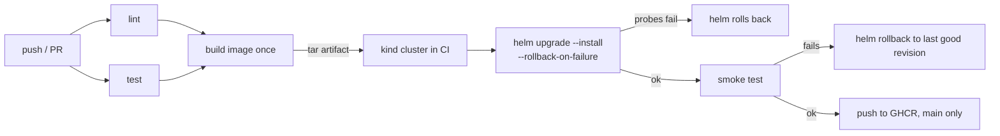

# cicd-k8s-delivery

A small Flask service and the pipeline that ships it: lint, tests, one image build, a Helm deploy into a throwaway kind cluster inside GitHub Actions, a smoke test, and an automatic rollback when the new release is bad.

## The problem

"helm upgrade exited 0" is a weak signal. A release can be rolled out with all probes green and still return errors on the one endpoint people actually use, and a release with a crashing pod can sit half-rolled-out until someone notices. I wanted to see both cases handled by the pipeline itself, and to be able to trigger them on demand instead of waiting for a real bad deploy.

## Pipeline



The image is built once and passed along as a tarball. It is loaded into kind for the deploy, and the same tarball is what gets pushed to GHCR afterwards, so the pushed image is the one that passed the smoke test. Nothing is pushed from pull requests.

Two separate things can catch a bad release:

- Helm itself, through the readiness probe and `--rollback-on-failure`, for pods that never become ready.
- `scripts/smoke.sh`, for a release that is ready but wrong. If it fails, `scripts/deploy.sh` runs `helm rollback` to the last superseded revision.

## Quick start

You need docker, kind, helm 4, kubectl, jq and python3.

```
make venv           # python deps (ruff, pytest, yamllint)
make lint           # ruff, yamllint, hadolint, helm lint, kubeconform
make test
make kind-up        # cluster "cicd-demo", kubeconfig goes to ./.kubeconfig
make deploy         # build, load into kind, helm upgrade --install, smoke test
make smoke
make rollback-demo FAULT=broken-endpoint
make kind-down
```

`make kind-up` writes its own `.kubeconfig` in the repo and the Makefile points `KUBECONFIG` at it, so your current kubectl context is not switched. The smoke test uses a port-forward on 18480 (`SMOKE_PORT=...` to change it).

On GitHub: Actions, `rollback-demo`, Run workflow, pick a fault.

## Rollback demo

`scripts/rollback-demo.sh` installs a healthy release (revision 1), upgrades it with a fault switched on through `config.fault` in the chart values, and then checks that the release is `deployed`, the fault is gone from the values, and the smoke test passes again.

| fault | what the app does | who notices |
| --- | --- | --- |
| `crash-on-start` | exits while booting | Helm: pods never become ready, upgrade times out and is rolled back |
| `unhealthy` | `/health` returns 503 | Helm, same way, through the readiness probe |
| `broken-endpoint` | `/health` is fine, `/` returns 500 | only the smoke test, then `helm rollback` |
| `none` | control run, changes the greeting only | nobody, the upgrade stays |

The history after a caught fault looks like this (revision 3 is the rollback, it is a new revision that restores the values of revision 1):

```
REVISION  STATUS      DESCRIPTION
1         superseded  Install complete
2         failed      Upgrade "greeter" failed: resource Deployment/demo/greeter not ready ...
3         deployed    Rollback to 1
```

## Verified

Run on a Mac under Colima, kind v0.33.0 with node image v1.35.8, Helm v4.2.4:

- `pytest`: 8 passed, on Python 3.9 in a venv and on 3.12 inside `python:3.12-slim`.
- `ruff check`, `ruff format --check`, `yamllint -s`, `hadolint` (2.15.1), `shellcheck` on the scripts, `helm lint --strict`, `kubeconform -strict` (3 resources valid): all clean.
- `actionlint` 1.7.12 on both workflow files: no findings.
- `docker build`, then the container run with a read-only root filesystem as uid 10001: `/health`, `/` and `/metrics` answer. `APP_FAULT=crash-on-start` exits with code 3.
- `make kind-up`, `make deploy`, `make smoke` against a real kind cluster: release installs, 2 pods ready, smoke passes.
- `scripts/rollback-demo.sh` against that cluster with each of `crash-on-start`, `unhealthy`, `broken-endpoint` and `none`: each ended with the expected outcome (helm rollback for the first two, smoke-test rollback for the third, upgrade kept for the control), `helm status` = deployed, smoke test passing afterwards. A control run also confirmed that changing only the ConfigMap restarts the pods, through the `checksum/config` annotation.
- A smoke failure on a first install, where there is no earlier revision, falls back to `helm uninstall`. I only saw this once, by accident, when a bug in my own trap made a passing smoke test exit non-zero.

Not verified, because it needs GitHub:

- The workflows have not run on GitHub yet. The first push may need a small fix.
- The buildx `type=docker` tarball, artifact upload/download, `helm/kind-action`, `azure/setup-helm` and the GHCR push were checked only by reading the docs and by actionlint. Locally the image was built with the plain Docker builder and loaded into kind directly.
- Whether the GHCR package ends up public. The Dockerfile sets `org.opencontainers.image.source`, which should link the package to the repo, but the visibility is a setting on GitHub.

## Limitations

- kind in CI is created from scratch on every run, so the regular `ci` deploy job only ever sees revision 1. A failed smoke test there falls back to uninstall. The real rollback path is exercised by the `rollback-demo` workflow, which installs a good revision first.
- The fault is a switch in the app, set from the chart values. It is not a real regression, just a reliable way to make one.
- The smoke test is three HTTP checks through a port-forward to one pod. No ingress, no load, nothing about data.
- Timeouts (90s for a deploy, 45s for the bad upgrade in the demo) were picked for an idle machine. While other containers were hammering the same Colima VM, a rollout that passes on an idle machine hit the timeout and the run failed with `Pending termination`. If you run it on a busy host, raise `HELM_TIMEOUT`.
- Helm is pinned to v4. `--rollback-on-failure` is the Helm 4 name of what Helm 3 called `--atomic`, and the scripts would need that one flag changed for Helm 3.
- Two replicas on one kind node, no PodDisruptionBudget, no HPA. CPU and memory requests/limits in `values.yaml` are starting guesses, not measured.
- The base image is pinned by tag, not digest. No image scanning or signing.

## Layout

```
app/                  Flask service, requirements
tests/                pytest
Dockerfile
chart/greeter/        Helm chart: deployment, service, configmap
kind/cluster.yaml     kind cluster, node image pinned by digest
scripts/deploy.sh     helm upgrade, smoke test, rollback on failure
scripts/smoke.sh      checks /health, /, /metrics
scripts/rollback-demo.sh
.github/workflows/    ci.yml, rollback-demo.yml
Makefile
```
