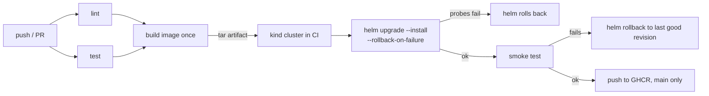

# cicd-k8s-delivery

A small Flask service and the pipeline that ships it: lint, tests, one image build, a Helm deploy into a throwaway kind cluster inside GitHub Actions, a smoke test, and an automatic rollback when the new release is bad.

## The problem

"helm upgrade exited 0" is a weak signal. A release can be rolled out with all probes green and still return errors on the one endpoint people actually use, and a release with a crashing pod can sit half-rolled-out until someone notices. I wanted to see both cases handled by the pipeline itself, and to be able to trigger them on demand instead of waiting for a real bad deploy.

## Pipeline



The image is built once and passed along as a tarball. It is loaded into kind for the deploy, and the same tarball is what gets pushed to GHCR afterwards, so the pushed image is the one that passed the smoke test. Nothing is pushed from pull requests.

Two separate things can catch a bad release:

- Helm itself, through the readiness probe and `--rollback-on-failure`, for pods that never become ready.
- `scripts/smoke.sh`, for a release that is ready but wrong. If it fails, `scripts/deploy.sh` runs `helm rollback` to the last superseded revision.

## Quick start

You need docker, kind, helm 4, kubectl, jq and python3.

```
make venv           # python deps (ruff, pytest, yamllint)
make lint           # ruff, yamllint, hadolint, helm lint, kubeconform
make test
make kind-up        # cluster "cicd-demo", kubeconfig goes to ./.kubeconfig
make deploy         # build, load into kind, helm upgrade --install, smoke test
make smoke
make rollback-demo FAULT=broken-endpoint
make kind-down
```

`make kind-up` writes its own `.kubeconfig` in the repo and the Makefile points `KUBECONFIG` at it, so your current kubectl context is not switched. The smoke test uses a port-forward on 18480 (`SMOKE_PORT=...` to change it).

On GitHub: Actions, `rollback-demo`, Run workflow, pick a fault.

## Rollback demo

`scripts/rollback-demo.sh` installs a healthy release (revision 1), upgrades it with a fault switched on through `config.fault` in the chart values, and then checks that the release is `deployed`, the fault is gone from the values, and the smoke test passes again.

| fault | what the app does | who notices |
| --- | --- | --- |
| `crash-on-start` | exits while booting | Helm: pods never become ready, upgrade times out and is rolled back |
| `unhealthy` | `/health` returns 503 | Helm, same way, through the readiness probe |
| `broken-endpoint` | `/health` is fine, `/` returns 500 | only the smoke test, then `helm rollback` |
| `none` | control run, changes the greeting only | nobody, the upgrade stays |

The history after a caught fault looks like this (revision 3 is the rollback, it is a new revision that restores the values of revision 1):

```
REVISION  STATUS      DESCRIPTION
1         superseded  Install complete
2         failed      Upgrade "greeter" failed: resource Deployment/demo/greeter not ready ...
3         deployed    Rollback to 1
```

## Verified

### On GitHub Actions

Hosted runner `ubuntu-24.04` (Docker 28.0.4), Helm v4.2.4 from `azure/setup-helm@v5`, kind v0.33.0 from `helm/kind-action@v1`, node image v1.35.8.

- `ci` on `main`: all five jobs green on the first run (lint, test, build, deploy-kind, publish), 2m18s end to end. A second run after small workflow edits took 2m13s. Rough job times from the first run: lint 18s, test 11s, build 21s, deploy-kind 64s, publish 22s.
- The buildx tarball goes through upload-artifact and download-artifact into two other jobs, and `docker load` and `kind load` worked on it. The smoke test reported the commit sha as the version, so the pod ran the image that was built in that run.
- GHCR push works with only `GITHUB_TOKEN` and `packages: write` on the publish job. Both `:latest` and the commit sha tag answer a manifest request with no credentials (HTTP 200 against ghcr.io with an anonymous pull token), so the package came out public, no manual step on the owner side. I did not read the package settings page, my token has no `read:packages`, and I did not `docker pull` and run the image from there.
- `rollback-demo` dispatched once per fault, all four green, 1m25s to 2m0s each:
  - `crash-on-start` and `unhealthy`: upgrade failed on the 45s timeout, Helm rolled back on its own, history shows revision 3 as `Rollback to 1`, smoke test passed afterwards.
  - `broken-endpoint`: Helm called the upgrade complete, `smoke FAIL: GET /`, then `helm rollback`, history again ends with `Rollback to 1`.
  - `none`: upgrade kept.

### Locally

Mac under Colima, same kind and Helm versions:

- `pytest`: 8 passed, on Python 3.9 in a venv and on 3.12 inside `python:3.12-slim`.
- `ruff check`, `ruff format --check`, `yamllint -s`, `hadolint` (2.15.1), `shellcheck` on the scripts, `helm lint --strict`, `kubeconform -strict` (3 resources valid): all clean.
- `actionlint` 1.7.12 on both workflow files: no findings.
- `docker build`, then the container run with a read-only root filesystem as uid 10001: `/health`, `/` and `/metrics` answer. `APP_FAULT=crash-on-start` exits with code 3.
- `make kind-up`, `make deploy`, `make smoke` and `scripts/rollback-demo.sh` with all four faults against a real kind cluster, same outcomes as on GitHub. A control run also confirmed that changing only the ConfigMap restarts the pods, through the `checksum/config` annotation.
- A smoke failure on a first install, where there is no earlier revision, falls back to `helm uninstall`. I only saw this once, by accident, when a bug in my own trap made a passing smoke test exit non-zero.

### Not verified

- The `pull_request` path (build and deploy without the publish job) has not run yet, only pushes and manual dispatches.
- The `cancel-in-progress` rule for PRs.

## Limitations

- kind in CI is created from scratch on every run, so the regular `ci` deploy job only ever sees revision 1. A failed smoke test there falls back to uninstall. The real rollback path is exercised by the `rollback-demo` workflow, which installs a good revision first.
- The fault is a switch in the app, set from the chart values. It is not a real regression, just a reliable way to make one.
- The smoke test is three HTTP checks through a port-forward to one pod. No ingress, no load, nothing about data.
- Timeouts (90s for a deploy, 45s for the bad upgrade in the demo) were picked for an idle machine. While other containers were hammering the same Colima VM, a rollout that normally passes hit the timeout and the run failed with `Pending termination`. On a busy host raise `HELM_TIMEOUT`, and `BAD_TIMEOUT` for the demo.
- For the same reason the `broken-endpoint` row is timing dependent. On a quiet machine the smoke test catches it. On the loaded VM with a 60s limit the new pod was not even ready in time, so Helm rolled back first and the smoke test never ran. With `BAD_TIMEOUT=120s` it was the smoke test again. The end state (healthy release back) was the same every time.
- Helm is pinned to v4. `--rollback-on-failure` is the Helm 4 name of what Helm 3 called `--atomic`, and the scripts would need that one flag changed for Helm 3.
- Two replicas on one kind node, no PodDisruptionBudget, no HPA. CPU and memory requests/limits in `values.yaml` are starting guesses, not measured.
- The base image is pinned by tag, not digest. No image scanning or signing.

## Layout

```
app/                  Flask service, requirements
tests/                pytest
Dockerfile
chart/greeter/        Helm chart: deployment, service, configmap
kind/cluster.yaml     kind cluster, node image pinned by digest
scripts/deploy.sh     helm upgrade, smoke test, rollback on failure
scripts/smoke.sh      checks /health, /, /metrics
scripts/rollback-demo.sh
.github/workflows/    ci.yml, rollback-demo.yml
Makefile
```
